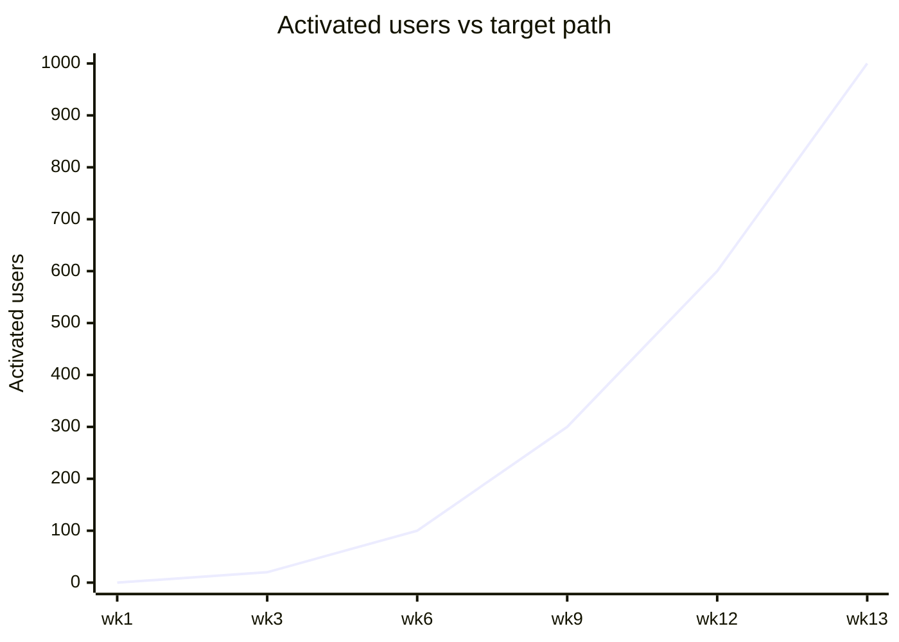

# KPI tracker — JBHNTR Team

Owner: CEO + CTO · Updated 2026-10-25 · Readable view of `../../state/KPIS.md` (the authoritative snapshot) and the BI dashboard (live, R1-05). **Real numbers only** — `—` = not measured.

## North star
**Activated users** = account + profile ≥70% complete + ≥1 search. Target **1,000** (~wk 13). Current: **—** (CTO populates from prod DB in cycle 1).

## Where we are vs the path
| Checkpoint | Target | Actual | On track? |
|---|---|---|---|
| Week 6 | ≥100 activated | — | — |
| Week 9 | ≥300 activated | — | — |
| Week 12 | ≥600 activated | — | — |
| Week 13 | 1,000 activated | — | — |

## Health metrics (Phase-1 gates)
| Metric | Target | Actual |
|---|---|---|
| Activation rate (signup→activated) | ≥55% | — |
| Gate: "vs how you search today" | ≥60% better, ≥30% much-better, stable 4 wks | — |
| Sean Ellis (day-14) | ≥40% "very disappointed" | — |
| D7 return (active) | ≥50% | — |
| Outcome events / active user / wk | ≥5 | — |
| K-factor | ≥0.3 by day 60 | — |
| Interview verdicts | ≥70% "wouldn't have found #1–3" | — |
| Unprompted mentions | ≥3/wk by day 90 | — |

**Phase gate:** gate holds + K ≥ 0.3 → Phase 2 (paid credits). Gate fails → stop acquiring, fix matching, repeat in the same geography.

## Budget
| | USD |
|---|---|
| Lifetime cap | 1,000 |
| Spent (actual) | — |
| Committed | — |
| Remaining | — |
| Revenue (paid credits) | — (Phase 2) |

## Target-path chart (update as data arrives)

